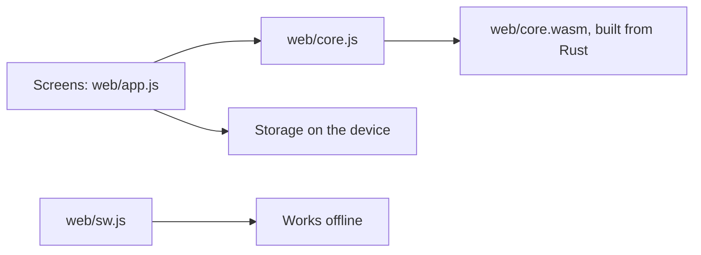

# Split Pay — the app

An installable web app. Rust does the money maths; the screens are plain web code with no framework and no build step.



## Folders

| Path | What it is |
|---|---|
| `core/src/lib.rs` | Rust: split methods, balances, simplify debts, currency conversion, plus 21 tests |
| `web/app.js` | All screens and actions |
| `web/media.js` | On-device storage, receipt photos, the share picture, file sharing |
| `web/core.js` | Loads the Rust core and calls it |
| `web/core.wasm` | The built Rust core (made by `build.ps1`, do not edit) |
| `web/styles.css` | Style A (Ink & Lime), dark and light |
| `web/sw.js`, `web/manifest.webmanifest`, `web/icons/` | Offline support and the home-screen icon |
| `build.ps1` | Runs the Rust tests, then rebuilds `web/core.wasm` |
| `package.ps1` | Zips `web/` into `dist/split-pay-web.zip` for upload |

## Run it on this PC

In Claude Code: start the preview named `split-pay` (defined in `C:\Claude\.claude\launch.json`). It serves `web/` at `http://localhost:8765`.

Or by hand:

```bash
python -m http.server 8765 --bind 127.0.0.1 --directory "C:\Claude\Split Pay\app\web"
```

## After changing the Rust code

```bash
powershell -ExecutionPolicy Bypass -File "C:\Claude\Split Pay\app\build.ps1"
```

Changes to `web/` files need no build: just reload the page.

## Put it on a phone

Host: **GitHub Pages**, from the repo `github.com/Raymondgio/split-pay`. Address: `https://raymondgio.github.io/split-pay/`.

How it works: every push to `main` runs `.github/workflows/pages.yml`, which publishes the `app/web` folder. No zip, no upload page.

First time only (on github.com, repo → Settings → Pages): set **Source** to **GitHub Actions**. The free plan only publishes **public** repos.

Updating later: commit and push to `main`. The phone picks up the new version the next time the app opens with internet. Data on the phone is not touched.

On the phone: open the address in Chrome → menu (⋮) → "Add to Home screen" (or "Install app").

What is public: the code and docs in the repo, and the empty app at the address. Expense data never leaves the phone.

Other hosts: `package.ps1` makes `dist/split-pay-web.zip` for drag-and-drop hosts such as Netlify or Cloudflare Pages.

## Changing the icon

Replace `web/icons/icon.svg`, `icon-192.png` and `icon-512.png`. Nothing else refers to the artwork.
