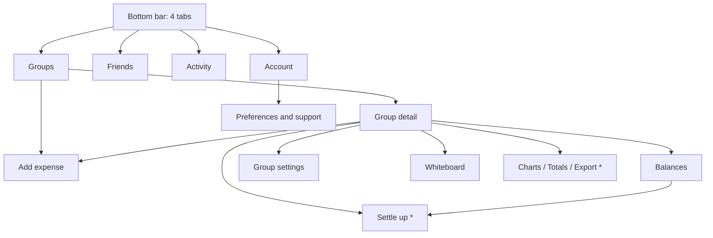

# App analysis — reference video

Source: `G:\My Drive\Agentic AI\Split Wise\splitwise 1.mp4` (65 seconds, Android, dark theme, currency IDR).
Screenshots: [reference-screens/](reference-screens/).

## Screen map

`*` = button is visible in the video, but the screen behind it was not opened.

## Screens seen in the video (9)

| # | Screen | What it shows | Screenshot |
|---|---|---|---|
| 1 | Groups (home) | Overall balance, group cards with per-person balances, "Non-group expenses", hidden settled-up groups, floating **Add expense** button | 01 |
| 2 | Group detail | Cover header, trip dates, people count, balance summary, action chips, expense list grouped by month | 02, 12, 13 |
| 3 | Add expense | "With you and: [group]", description, currency + amount, "Paid by **you** and split **equally**", date / photo / note icons | 03 |
| 4 | Friends | Each friend with "you owe" / "owes you" / "no expenses" | 04 |
| 5 | Activity | Feed: "Nico J. added 'Fore' in 'Jalan Pagi'. You get back IDR12,500" | 05 |
| 6 | Account | Profile, scan code, email / notification / security / appearance settings, help | 06, 07 |
| 7 | Group settings | Rename, member list with balances, add people, invite link, simplify debts toggle, leave / delete group | 08, 09 |
| 8 | Balances | Per member: total owed, who owes whom, **Remind** and **Settle up** buttons | 10, 11 |
| 9 | Whiteboard | Free-text notes shared with the group | 14 |

## Feature list

**Core loop (must work first)**
1. Create a group and add members.
2. Add an expense: description, amount, who paid, how to split.
3. See the expense list: date, title, who paid, "you lent" / "you borrowed" / "not involved".
4. See balances: who owes whom, per group and overall.
5. Settle up: record a payment between two people.

**Around the core**
6. Friends tab (balance per person across all groups).
7. Activity feed.
8. Simplify group debts (fewer repayments).
9. Whiteboard notes.
10. Group types and icons (Trip, etc.), trip dates.
11. Expense categories (food, drinks, games — shown as icons).
12. Hide groups / friends settled up over one month.

**Locked behind "Pro" in the original — free in Split Pay**
13. Convert currency.
14. Charts.
15. Default split per group.
16. Search.
17. Receipt photo.

## What "no ads" removes

| Item | Seen in video? |
|---|---|
| "Get Pro" card on Account tab | Yes |
| "Trip Pass" card in Group settings | Yes |
| PRO locks on Convert, Charts, Default split | Yes |
| Full-screen ads after adding an expense | No — known from the free version, to confirm |
| Daily limit on number of expenses | No — known from the free version, to confirm |

## Gaps — not shown in the video

These screens exist in the original but were not opened in the recording. Split Pay needs them, so they will be designed from general knowledge unless a second video is recorded.

Update 15 Nov 2026: the APK check filled in the options for gaps 4 and 5 and confirmed the rest exist — see [04-apk-findings.md](04-apk-findings.md).

1. Sign up / log in.
2. Create group.
3. Expense detail (edit, delete, comments).
4. Split options (unequal amounts, percentages, shares).
5. Choose payer (including more than one payer).
6. Settle up flow.
7. Charts, Totals, Export.
8. Friend detail.
9. Category and currency pickers.

## Data seen (helps the data model)

- 1 active group, 8 members, about 3 months of history, roughly 100+ entries.
- Amounts have 2 decimals even in IDR (e.g. `IDR25,144.80`) — the result of equal splits.
- Two kinds of entries: **expenses** (shared cost) and **payments** (one person pays another).
