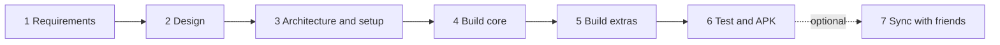
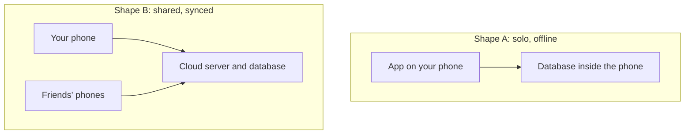

# Roadmap — from idea to .apk

**Yes — requirements come first.** One answer (who uses the app, and whether phones must sync) changes the whole architecture, so it is decided before anything is drawn or coded.

| Phase | What happens | Output | Who |
|---|---|---|---|
| 1. Requirements | Interview, one question at a time | [03-requirements.md](03-requirements.md) filled in | Raymond answers, Claude writes |
| 2. Design | Screen list, data model, colours, name, icon | Mock-ups to approve | Claude drafts, Raymond approves |
| 3. Architecture and setup | Pick tools, install them on this PC | Empty app running on the phone | Claude guides installs |
| 4. Build core | Groups → add expense → balances → settle up | First usable `.apk` | Claude codes, Raymond tests |
| 5. Build extras | Friends, activity, charts, export, whiteboard, currency | Full-feature `.apk` | Same |
| 6. Test and APK | Real data, fix bugs, sign the app | Final `.apk` | Same |
| 7. Sync (optional) | Accounts + server so friends see the same data | Shared version | Only if chosen in Phase 1 |

## Architecture — two possible shapes

| | Shape A: solo | Shape B: shared |
|---|---|---|
| Who enters expenses | Only you | Everyone |
| Internet needed | No | Yes |
| Accounts / login | No | Yes |
| Running cost | Free | Free tier at this size, can cost later |
| Build effort | Smaller | About 2x |
| Friends must install the app | No | Yes |

Recommended path: build Shape A first, with a data model that is ready for Shape B, then add sync as Phase 7.

## Tools — final choice (16 Nov 2026)

Raymond chose an installable web app with a Rust core instead of the Flutter `.apk` described below. This replaces the table that follows.

| Layer | Final pick | Why |
|---|---|---|
| Money maths | Rust, compiled to WebAssembly | Exact whole-number maths with tests; reusable by a sync server later |
| Screens | Plain web code (HTML, CSS, JavaScript), no framework | Nothing to install, quick to change |
| Storage | The browser's on-device database | Works offline |
| Install | "Add to Home screen" from Chrome | One-tap icon, no `.apk` needed |
| Hosting | Any free static host with https; no VPS | The app is only files |
| Sync (phase 7) | Managed free database, or own Rust server on a VPS | Decided when phase 7 starts |

## Tools — earlier recommendation (replaced)

| Layer | Pick | Why |
|---|---|---|
| App framework | Flutter | One codebase, builds `.apk` on Windows, also covers iPhone later |
| Local database | SQLite (via Drift) | Works offline, fast, handles thousands of expenses |
| Sync (Phase 7) | Supabase | Login + cloud database, free tier |

Confidence in this pick: about 85% after interview answers 1 and 2 (mostly Android, web app also fine): Flutter builds the `.apk` and a web app from the same code.

## PC check (15 Nov 2026)

| Tool | Status |
|---|---|
| Node.js, Git | Installed |
| Flutter, Java, Android Studio, Android SDK | Not installed — needed in Phase 3 |
