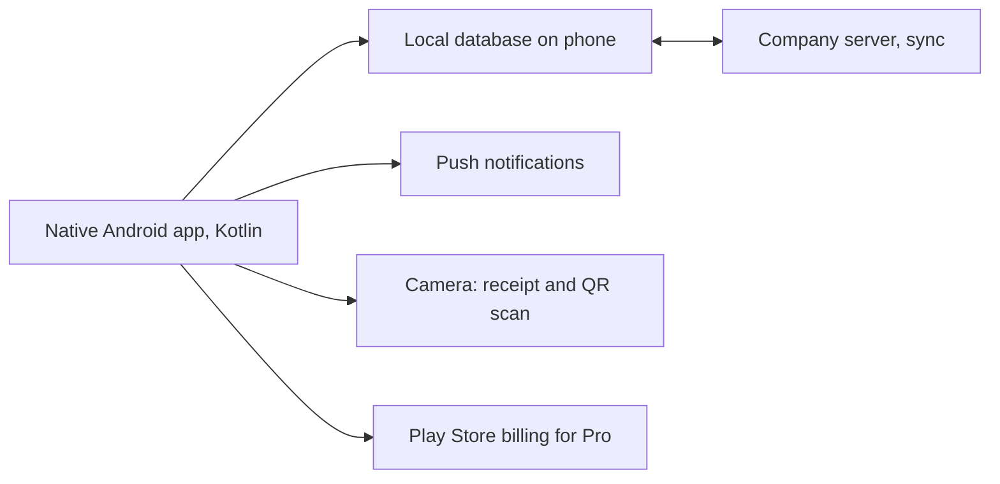

# APK findings — reference app

Source: `G:\My Drive\Agentic AI\Split Wise\splitwise-26-11-1.apk` (136 MB, version 26.11.1, checked 15 Nov 2026).

## How it was checked

- Read-only. The APK was not installed, run or modified.
- Two things were read: the manifest (list of screens, permissions, services) and the text labels (2,552 labels, 14 languages).
- The code was not decompiled. Split Pay does not reuse the APK's code, images or wording — the APK is only a checklist of features.

## How the original is built

| Part | What the original uses | Needed in Split Pay? |
|---|---|---|
| App | Native Kotlin, needs Android 9 or newer | Yes (own framework choice) |
| Local database | Yes, so the app works offline, then syncs | Yes |
| Server sync | Yes, all data lives on the company server | Only if "shared" is chosen |
| Push notifications | Yes | Only if "shared" is chosen |
| Receipt scan (text recognition) | Yes | Optional |
| QR code scan | Yes, to add friends | Only if "shared" is chosen |
| Charts | Yes | Yes |
| Store billing | Yes, for Pro | No |
| Bank linking, card, in-app payments | Yes, US only | No |

## Ads — what the APK confirms

| Check | Result |
|---|---|
| Third-party ad network inside the app | None found in the manifest |
| What the "ads" are | The app's own Pro promotions (labels for charts, search, receipt scan, totals, sidebar) |
| Pro check | Done against the company server, not inside the app |
| Daily expense limit | No label for it in the APK — cannot confirm from this file |

## Features found that the video did not show

**Add expense**
1. Five split methods: equally, exact amounts, percentages, shares, adjustment.
2. Paid by one person or by multiple people.
3. Repeat: weekly, fortnightly, monthly, yearly.
4. Note, receipt photo, date.
5. Itemize a scanned receipt: assign each item to a person.

**Expenses**
6. Comments on an expense.
7. Delete and restore an expense.
8. Search.

**Groups**
9. Group types: Home, Trip, Couple, Other.
10. Trip dates, with settle-up reminders at the end.
11. Totals ("group spending summary": total spent, your share).
12. Charts.
13. Export data as a spreadsheet.
14. Invite via link.

**Friends and settling**
15. Filters: friends who owe you, friends you owe.
16. Remind a friend (message with a settle-up link).
17. Settle up: record a payment.

**Account and security**
18. Login: email and password, Google sign-in, login link by email, password reset.
19. App lock: passcode and fingerprint.
20. Appearance: light, dark, system default.
21. Email and notification settings.

**US-only money features — recommended to leave out**
22. In-app payments between friends.
23. A payment card.
24. Import of bank transactions.

## What this changes

- Gaps 4 and 5 in [01-app-analysis.md](01-app-analysis.md) (split options, payer) are now known.
- The original is a "shared, synced" app (Shape B in [02-roadmap.md](02-roadmap.md)). The recommendation stays the same: build solo first, add sync later.
- Changing this APK to remove the Pro locks is not part of this project: the locks are checked on the company's server, the data lives there, and it would not give an app that can be customised.
