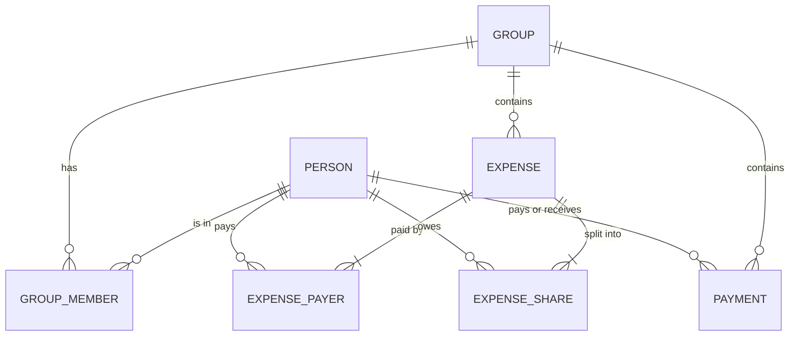

# Data model

How Split Pay stores its data on the phone. Written 16 Nov 2026, based on the signed-off requirements.

## Picture

## Tables in plain words

| Table | One row is | Main fields |
|---|---|---|
| Person | You or a friend | name, colour, "is me" flag |
| Group | A group such as "Bali Trip" | name, type (Home, Trip, Couple, Other), icon, simplify-debts on/off |
| Group member | One person in one group | group, person |
| Expense | One shared cost | group, description, category, amount, currency, date, note, split method |
| Expense payer | Who paid, and how much | expense, person, amount paid |
| Expense share | Who owes, and how much | expense, person, amount owed |
| Payment | One person paying another back | group, from, to, amount, currency, date, note |
| Activity | One line in the Activity tab | what happened, when, which expense or payment |

"Non-group expenses" is stored as a hidden group, so it follows the same rules as every other group.

## Five rules

1. **Balances are never stored.** They are always calculated from expenses and payments, so they can never drift out of date.
2. **Money is stored as whole numbers** in the smallest unit of the currency (rupiah, yen, cents). No rounding errors.
3. **Every amount carries its currency.** Balances are added up per currency and never mixed.
4. **Splits must add up exactly.** When an amount does not divide evenly, the leftover units go to the first people in the list, one unit each.
5. **Ready for sync later.** Every row has a unique ID that works across phones, a "last changed" time, and deleted rows are marked as deleted instead of erased.

## How each split method becomes shares

| Method | You enter | Stored as |
|---|---|---|
| Equally | Who takes part | Amount ÷ people, leftover by rule 4 |
| Exact amounts | An amount per person | Those amounts (must total the expense) |
| Percentages | A percent per person | Amount × percent (must total 100%) |
| Shares | A number of shares per person | Amount × shares ÷ total shares |
| Adjustment | Extra per person | Extra, plus the remainder split equally |

Whatever the method, the result is always one "amount owed" per person, so balances are calculated the same way for all five.

## Backup file

One file containing all tables, plus a version number so newer app versions can still read older backups.

## Added in version 1.1 (17 Nov 2026)

| Where | New field | Meaning |
|---|---|---|
| Group | `nongroup` | The one hidden group that holds "Non-group expenses"; every person is a member |
| Group | `whiteboard`, `tripStart`, `tripEnd` | Notes and optional dates |
| Expense | `repeat`, `repeatDay` | Never, weekly, fortnightly, monthly, yearly. Only the newest copy repeats |
| Expense | `photoId` | Key of the receipt photo |
| Settings | `categories`, `presets`, `rates`, `lock` | Own categories, saved groups of people, typed exchange rates (1 X = ? IDR), PIN hash and salt |
| Storage | `photos` store | Photos are kept apart from the main data so saving stays fast; the backup file includes them |

Older data is upgraded automatically when the app opens (tested with a 1.0-shaped dataset).

Conversion is done in Rust: rates are stored as millionths of IDR per unit, and a converted expense is re-split by the original amounts so it still adds up exactly.
