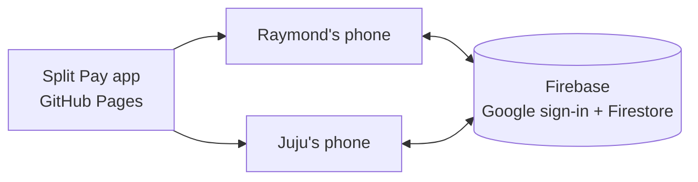

# Phase 7 — Sync with friends (plan)

Started 17 Nov 2026. Goal: friends add expenses to the same group from their own phones.

## Picture

- **App**: stays on GitHub Pages, as now.
- **Shared data**: Firebase (Google). Free Spark plan, no payment method. Limits: 50,000 reads and 20,000 writes per day (checked 17 Nov 2026 on firebase.google.com/pricing). A group of 10 uses a few hundred a day.
- **Not on the free plan**: Cloud Storage. Receipt photos stay on the phone that took them.

## How a friend joins

1. Raymond creates "Astra Runners" with Juju, Joeky and Nico (names only, as today).
2. Raymond taps **Share group** → the group is uploaded → he gets an invite link and sends it on WhatsApp.
3. Juju opens the link → signs in with Google → picks **"I am Juju"**. The name now belongs to Juju's account.
4. Everyone sees new expenses within seconds. Offline changes upload when the internet comes back.

## Rules

- Groups not shared stay only on the phone, as today.
- Only signed-in members of a group can read or change it (Firestore security rules).
- Deletes are marks, not erasures, so two phones never lose each other's changes.
- Money maths stays in the Rust core; Firebase only stores the same expense rows.

## Steps

| # | Step | Who |
|---|---|---|
| 7.1 | Create the Firebase project, turn on Google sign-in and Firestore, copy the web config | Raymond (guided) |
| 7.2 | Sign in with Google inside Split Pay | Claude |
| 7.3 | Share a group: upload + invite link | Claude |
| 7.4 | Join by link, claim a name | Claude |
| 7.5 | Live updates and offline queue | Claude |
| 7.6 | Security rules, then test with two Google accounts | Claude, Raymond tests |
| 7.7 | Later: notifications, comments (bucket C) | — |

## Firebase setup (step 7.1)

1. console.firebase.google.com → **Create a project** → name `split-pay` → Google Analytics **off**.
2. **Build → Authentication → Get started → Google → Enable** → Save. Then Settings → **Authorized domains → Add** `raymondgio.github.io`.
3. **Build → Firestore Database → Create database** → location **asia-southeast2 (Jakarta)** (cannot be changed later) → **production mode**.
4. **Project settings (gear) → Your apps → Web `</>`** → nickname `split-pay`, Firebase Hosting **off** → copy the `firebaseConfig` block.

The `firebaseConfig` values are meant to be public (they go inside the app). They are not passwords.
