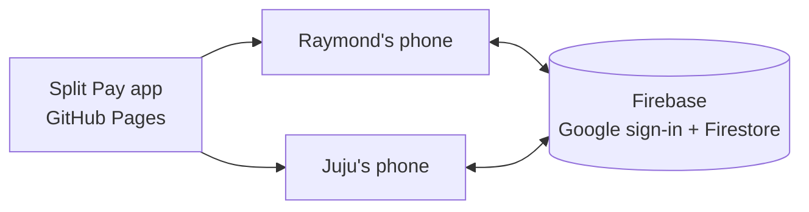

# Phase 7 — Sync with friends (plan)

Started 17 Nov 2026. Goal: friends add expenses to the same group from their own phones.

## Picture

- **App**: stays on GitHub Pages, as now.
- **Shared data**: Firebase (Google). Free Spark plan, no payment method. Limits: 50,000 reads and 20,000 writes per day (checked 17 Nov 2026 on firebase.google.com/pricing). A group of 10 uses a few hundred a day.
- **Not on the free plan**: Cloud Storage. So receipt photos are stored small, inside Firestore itself (see 20 Nov below).

## How a friend joins

1. Raymond creates "Astra Runners" with Juju, Joeky and Nico (names only, as today).
2. Raymond taps **Share group** → the group is uploaded → he gets an invite link and sends it on WhatsApp.
3. Juju opens the link → signs in with Google → picks **"I am Juju"**. The name now belongs to Juju's account.
4. Everyone sees new expenses within seconds. Offline changes upload when the internet comes back.

## Rules

- Groups not shared stay only on the phone, as today.
- Only signed-in members of a group can read or change it (Firestore security rules).
- Deletes are marks, not erasures, so two phones never lose each other's changes.
- Money maths stays in the Rust core; Firebase only stores the same expense rows.

## Steps

| # | Step | Who |
|---|---|---|
| 7.1 | Create the Firebase project, turn on Google sign-in and Firestore, copy the web config | Raymond (guided) |
| 7.2 | Sign in with Google inside Split Pay | Claude |
| 7.3 | Share a group: upload + invite link | Claude |
| 7.4 | Join by link, claim a name | Claude |
| 7.5 | Live updates and offline queue | Claude |
| 7.6 | Security rules, then test with two Google accounts | Claude, Raymond tests |
| 7.7 | Later: notifications, comments (bucket C) | — |

Status 17 Nov 2026: 7.1–7.5 built in version 1.2. Rules from `firestore.rules` published; checked that a visitor without sign-in cannot read or write. The merge rules were tested by simulating two phones (share → join → "I am Juju" → both phones end with identical rows). Not yet tested: real sign-in with two Google accounts (7.6).

20 Nov 2026: log-in changed from Google sign-in to **email + password** (Raymond's choice). Firebase Email/Password provider turned on. Screens: Log in, Create account, Forgot password (Firebase emails a reset link). The join screen shows "Create an account" first. Google provider is still on in the console but no longer used by the app.

20 Nov 2026 (later): **log-in is required for everyone** before the app opens (Raymond's rule). Order on start: log-in → (phone holds another account's data? → log out or erase) → name, or restore the latest online backup → app. The phone's data remembers its owner account, also after log-out. Offline: works if the phone was logged in before; the very first log-in needs internet.

20 Nov 2026: **online backup** in Firebase: `users/{uid}/backups/{id}` (header) + `/parts/{n}` (text in pieces of 800,000 characters). Includes everything on the phone: all groups (also unshared), friends, settings, photos. Automatic once a day while logged in (never from an empty phone), plus "Back up online now" and "Restore from online backup" in Account. Newest 5 kept. Rules: only the owner account can read or write `users/{uid}/…` (published).

20 Nov 2026: receipt photos of shared groups are shared too. Each photo is shrunk to a small JPEG (about 70–130 KB, max 1000 px) and stored in Firestore at `groups/{groupId}/photos/{photoId}`, members only (rules updated and published). Every phone downloads a photo once and keeps it, so it also shows offline. No Cloud Storage, so no paid plan. Free 1 GB ≈ 8,000+ receipts.

Known limits:
- A removed or replaced photo stays stored online (it is just no longer linked), so it still uses space.
- If two people edit the same expense at the same moment, the later save wins.
- A member cannot be removed from a shared group's accounts yet (only from the names list).

## Firebase setup (step 7.1) — done 17 Nov 2026

Project `split-pay-5cf1a` (Spark plan). Google sign-in on (public name "Split Pay"), authorized domain `raymondgio.github.io` added, Firestore Standard edition in asia-southeast2 (Jakarta), production mode (all access denied until our rules are published). No scheduled backups (paid plan only). Web app `split-pay` registered; config saved in `app/web/firebase-config.js` and checked against Google's API.

Steps that were followed:

1. console.firebase.google.com → **Create a project** → name `split-pay` → Google Analytics **off**.
2. **Build → Authentication → Get started → Google → Enable** → Save. Then Settings → **Authorized domains → Add** `raymondgio.github.io`.
3. **Build → Firestore Database → Create database** → location **asia-southeast2 (Jakarta)** (cannot be changed later) → **production mode**.
4. **Project settings (gear) → Your apps → Web `</>`** → nickname `split-pay`, Firebase Hosting **off** → copy the `firebaseConfig` block.

The `firebaseConfig` values are meant to be public (they go inside the app). They are not passwords.
